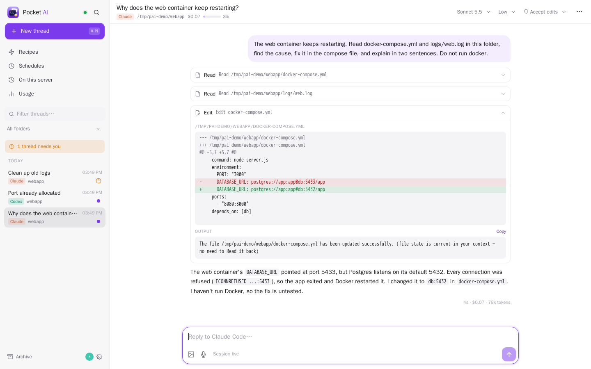
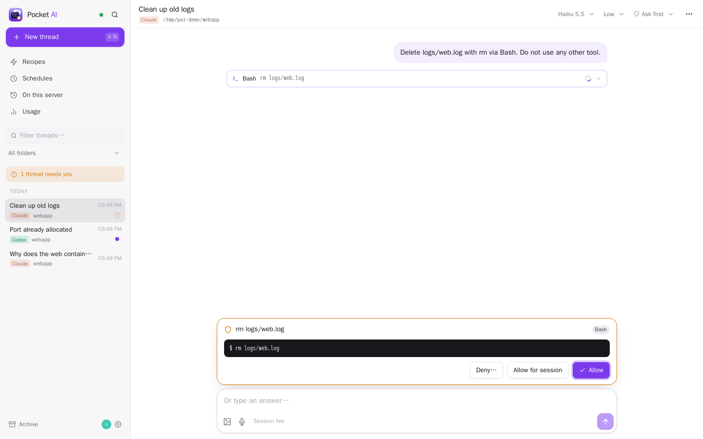
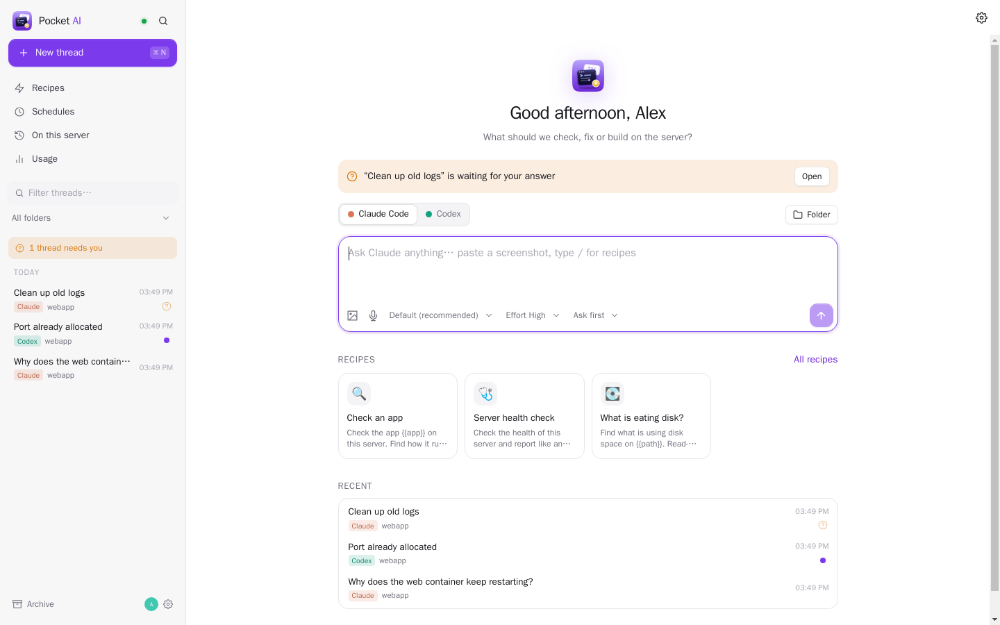
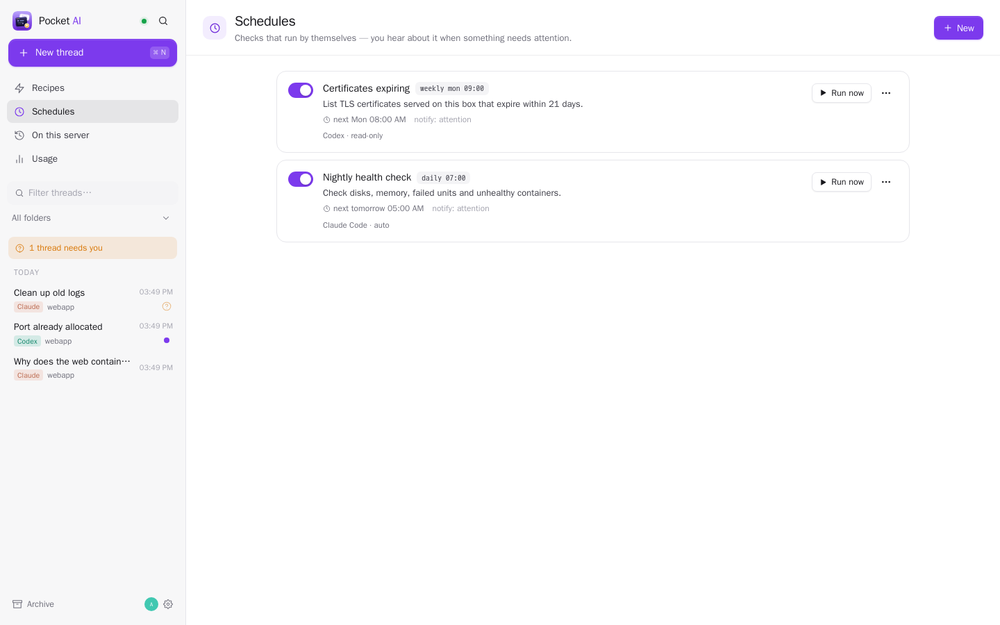
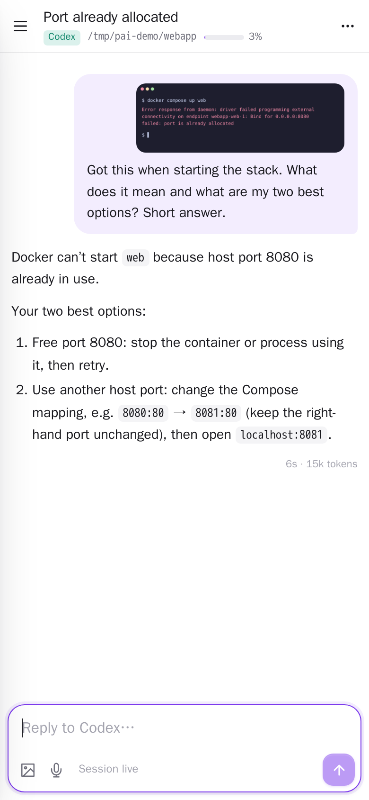
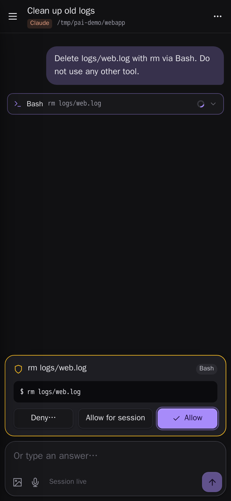

<p align="center"></p>

Personal app assistance: [Briefing, workflows, memory, sources and document uploads](docs/assistant.md).
<h1 align="center">Pocket AI</h1>
<p align="center">Claude Code and Codex on your own server, from any browser or phone: ask it to check your apps and your box, watch what it does, approve what it wants to run, paste a screenshot into the prompt — and let saved checks run on a schedule and tell you when something needs attention.<br>One Go binary, one SQLite file. It drives the CLIs already installed and logged in on the server.</p>

<p align="center"></p>

<table>
  <tr>
    <td width="50%"></td>
    <td width="50%"></td>
  </tr>
  <tr>
    <td align="center"><sub>The agent asks before it runs something; answer from wherever you are.</sub></td>
    <td align="center"><sub>Start a thread with either CLI, or tap a recipe.</sub></td>
  </tr>
  <tr>
    <td width="50%"></td>
    <td width="50%" align="center">
      &nbsp;
      
    </td>
  </tr>
  <tr>
    <td align="center"><sub>Scheduled checks answer OK or ATTENTION; you hear only about the second.</sub></td>
    <td align="center"><sub>On the phone: send a screenshot, approve a command.</sub></td>
  </tr>
</table>

## What it does

**Your agents, not a new one**
- Talks to the `claude` and `codex` CLIs that are already installed and signed in on the server: Claude Code
  through its stream-json protocol, Codex through `codex app-server`. Your subscriptions, your `CLAUDE.md` /
  `AGENTS.md`, MCP servers, skills and settings all apply, exactly as in a terminal.
- Model, effort and permission mode per thread (Claude: ask first, accept edits, plan, auto, full access; Codex:
  ask first, sandboxed, read only, full access), changeable mid-thread — the session is resumed with the new flags.
- **More than one account**: add more Claude Code / Codex logins in Settings (signed in from the browser, each
  in its own folder, sharing your settings and skills), pick the account per thread next to the model, and
  switch mid-thread when one hits its limit; the conversation is moved over and carries on. Limits show per
  account.
- Every thread is a real CLI session: it resumes after a restart, and **On this server** lists the sessions you
  started in a terminal (or in another tool) so you can open and continue them here.

**Pocket apps, directly**
- Enable Pocket Ask once from an app. Ordinary Claude and Codex threads then use that person's app tools directly, including when resuming a saved conversation.
- Spending questions use Money's aggregate report in one call; Notes tools identify folders by their paths. Agents can combine app reads and prepare changes without searching server files for API credentials.
- Every Pocket write requires approval of that operation, even in a full-access coding thread. Your coding model, effort and permissions stay as selected.
- See [Pocket Ask architecture and access rules](https://github.com/abjelosevic88/pocket-homelab-core/blob/main/docs/ask.md).

**Made for the phone**
- Streams text, thinking, tool calls with their output, diffs of edited files, and the agent's to-do list as it
  works. Consecutive tool calls share a compact summary; expand it to inspect each input and result. Errors and image previews remain visible.
- Permission prompts, questions (`AskUserQuestion`, Codex `request_user_input`) and plans to approve appear as
  cards above the composer. Allow once, allow for the session, or deny with a note.
- **Images in the prompt**: paste a screenshot, drag one in, or use the camera/photo library on an iPhone. Claude
  gets image blocks, Codex local image inputs. Large photos are shrunk in the browser first.
- Type while it works: messages queue and go out when the turn ends. Stop any time.
- A push through Apprise / ntfy / a webhook when a turn finishes, fails or waits for you — only when you are not
  already looking at that thread. Browser notifications and an app badge when installed as a PWA.

**Checks that run themselves**
- **Recipes** are saved prompts with their agent settings and `{{placeholders}}` ("Check an app: {{app}}"); one
  tap to run. Starter recipes for server health, a misbehaving app, disk space, container updates, recent errors.
- **Schedules** run a prompt every N minutes/hours, daily, on weekdays, weekly or on a cron line. The agent ends
  with `OK: …` or `ATTENTION: …`; you are notified always, only on attention, or never.

**And**
- Full-text search over everything said, usage per day and per provider (cost for Claude, tokens for both) and the
  live 5-hour / weekly limit windows both CLIs report.
- Fork a thread (the agent session is forked too), export it as Markdown, pin, archive, workspaces for the folders
  you use most, a folder picker limited to the folders you allow.
- Per person, like every Pocket app: nobody sees anyone else's threads, admins included. Members may only run
  agents when an admin allows it (agents run as the server's Unix user). Sign in with Pocket Core, API tokens,
  Pocket Core events (`ai.turn_finished`, `ai.needs_input`, `ai.schedule_attention`).

## Compared with Paseo

Pocket AI started as "Paseo, for this homelab". Paseo is a daemon with its own app and a hosted web client
reached through a relay, many agent providers, git worktrees and terminals — a coding cockpit. Pocket AI is
narrower and lives with the other Pocket apps:

- a plain web app/PWA on your own domain and network — no relay, no separate account;
- Pocket accounts and Sign in with Pocket Core, per-person data, an admin switch for who may run agents;
  chats are private until you share one (per person: can view, or can chat in it too), and
  the server-wide lists (On this server, Today, Running now) show each person only their own chats, and
  terminal / Paseo sessions only to admins. (Agents still run as the server's user, so whoever may run
  agents can read its files: give that switch only to people you trust with a shell.)
- built around looking after a server: recipes with placeholders on the start screen, schedules that answer
  OK / ATTENTION and only notify on attention, pushes through the Apprise / ntfy route the box already uses;
- every Claude Code and Codex session on the server listed and resumable, full-text search, usage per day;
- only Claude Code and Codex.

## Run it

Pocket AI must run **on the host, as the user whose CLIs it drives** — not in a container. Agents get that user's
files, PATH and logins, so treat access to it like SSH access.

```sh
make all                       # web UI + binary (Go 1.26, Node 22)
make install                   # → ~/.local/bin/pocket-ai
make service                   # systemd user unit; edit ~/.config/pocket-ai/env first (see .env.example)
loginctl enable-linger $USER   # keep it running without a login session
```

Put it behind your reverse proxy with TLS (it streams Server-Sent Events; Caddy and nginx with
`proxy_buffering off` work) and keep it on a private network. It listens on `127.0.0.1:8195` by default; `HOST`
takes several addresses (`127.0.0.1,172.17.0.1` lets a proxy in Docker reach it). `AUTH_MODE=none` is refused on
anything but loopback. All options: [docs/configuration.md](docs/configuration.md). API: [docs/api.md](docs/api.md).
How it talks to the CLIs: [docs/design.md](docs/design.md).

## Built with

Go (chi, modernc SQLite with FTS5), React 19 + Vite, marked + DOMPurify. The Pocket Core SDK snapshot is vendored
in `third_party/pocket-core` and checked by hash in CI. MIT licensed.

## Text generation for linked Pocket apps

Travel, Money, Day and Bookshelf can reuse Pocket AI instead of storing another
OpenAI API key. Register the updated apps with Core and approve their **Generate
text** link (`inference:write`) in Core's Links page. Existing app updates do not
auto-approve new permissions; each person can also disable the link.

`POST /api/v1/inference` accepts `{ "system": "...", "prompt": "...", "json": true }`
and returns text, model and token usage. It requires a Core delegated token for
that person, audience `ai`, scope `inference:write`. Such tokens cannot access
normal account, conversation or agent-control endpoints. Inference uses the
person's selected Claude account and model, with a private temporary workspace,
no tools/MCP/hooks, and no saved CLI session. It does not transcribe audio or
perform web searches. At most four requests run at once, each bounded to 140
seconds. Busy responses and model failures are surfaced to the calling app.

Pocket AI model selection: AI settings offer the models discovered from your connected Claude account. “Use Pocket AI default” follows your current model in Pocket AI (Sonnet when no model is set). An explicit choice is saved per person in this app and never changes the Pocket AI default or your OpenAI model. Loading models does not create a chat or send a generation prompt. If a saved model is no longer offered, choose another model or return to the default; generation does not silently substitute a different model.

### Personal model defaults

Set your default for connected apps in **Pocket AI → Settings → App defaults**. This is personal to your account and applies on the next text-generation request in Travel, Money, Day, and Bookshelf when the app uses “Use Pocket AI default”. A model chosen in an individual app takes precedence. “Follow Claude default” preserves existing behavior: use your Claude model under Agents, or Sonnet when no specific model is selected. Claude and Codex chat defaults remain under Agents. Core manages app connections and permissions; model preferences live in Pocket AI alongside your connected accounts.
